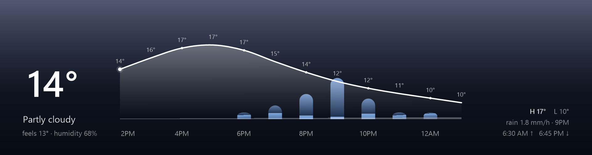

# weather-overlay

A weather band for the bottom of the screen. It runs once at logon, draws the
next few hours as a temperature line with precipitation behind it, then closes
itself on the next mouse click.



Zig 0.17, Win32, GDI+, WinHTTP. One exe of about 620 KB with no runtime of its
own, and about 10 MB of private memory, most of it the framebuffer.

The window is layered and click-through, so it never takes focus and clicks land
on whatever is underneath. Dismissal uses a low-level mouse hook that only
watches and always forwards the click.

## Build

```powershell
zig build -Drelease -Dgui
```

Output goes to `zig-out\bin\weather-overlay.exe`. Without `-Dgui` you get a
console build, which is easier to debug.

## Run

```powershell
.\zig-out\bin\weather-overlay.exe
.\zig-out\bin\weather-overlay.exe --mock
.\zig-out\bin\weather-overlay.exe --hold
.\zig-out\bin\weather-overlay.exe --boot
.\zig-out\bin\weather-overlay.exe --dump out.png --bg photo
```

`--mock` skips the network. `--hold` leaves the dismiss hook out, so the window
stays until the process is killed. `--boot` is what the Run entry passes: same
band, but without the 90 s failsafe, so it is still on screen however long you
were away and closes on the first click. `--dump` writes the band to a PNG
instead of showing it; `--bg` picks the backdrop it is composited over (`dark`,
`bright` or `photo`).

## Configuration

`%APPDATA%\weather-overlay\config.json`, written on first run:

```json
{
  "apiKey": "",
  "lat": null,
  "lon": null,
  "hours": 12,
  "fadeOutMs": 450
}
```

Fill in `apiKey`, `lat` and `lon` to get a real forecast. While any of them is
missing the band draws a canned day, so it still appears.

One Call 3.0 is asked for first, being the only endpoint with hourly data, but
it needs its own subscription (1,000 calls a day free, card on file). A plain
key answers 401 there, and the code falls back to `/data/2.5/forecast`, which
every key can use. Those points are three hours apart, so `hours` then covers
three times the span it claims.

`fadeOutMs` is the dismiss animation, clamped to 80..2000. Progress is read from
the clock rather than counted in timer ticks, so the duration holds even when
Windows coalesces the timer.

## Autostart

```powershell
.\zig-out\bin\weather-overlay.exe --install
.\zig-out\bin\weather-overlay.exe --uninstall
```

`--install` copies the binary into `%LOCALAPPDATA%\weather-overlay\` and points
an HKCU Run entry at the copy, so rebuilding cannot change what starts at logon.
The entry passes `--boot`, so the logon band has no failsafe timeout and waits
for a click instead of fading out after 90 s.

## Log

`%LOCALAPPDATA%\weather-overlay\log.txt`, one line per event. A GUI build has no
console, so this is the only record.

When a fetch fails and nothing is cached, no window is drawn at all.

## Layout

`src/draw.zig` expresses the geometry as fractions of a 1920-wide box, so the
band keeps its proportions at any resolution. On very wide monitors the layout
width is capped and centred. The constants at the top of the file are the whole
design.

The scrim is a four-stop vertical ramp applied per pixel after GDI+ has
finished, because GDI+ treats pixels already present in a PARGB bitmap as
straight alpha. `clampPremul` then forces `rgb <= a`, which UpdateLayeredWindow
requires.

## Files

| file | role |
| --- | --- |
| `src/main.zig` | flags, single instance, fetch or cache, PNG dump |
| `src/overlay.zig` | layered window, blit, fade, mouse hook, message loop |
| `src/draw.zig` | scrim, bars, spline, labels |
| `src/model.zig` | forecast types, One Call mapping, mock day |
| `src/http.zig` | WinHTTP GET |
| `src/config.zig` | config file and app/cache/log paths |
| `src/gdiplus.zig` | GDI+ flat API bindings |
| `src/win.zig`, `src/win.h` | translated Win32 headers |
| `src/autostart.zig` | HKCU Run key |
| `src/png.zig` | PNG writer for `--dump` |

## License

MIT. See [LICENSE](LICENSE).
